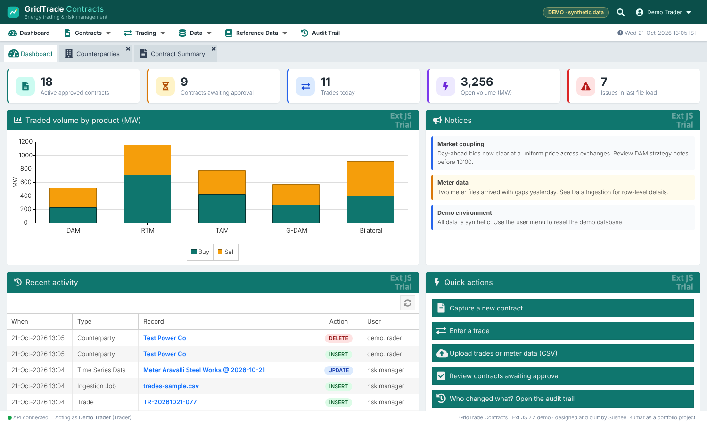

# GridTrade Contracts (Ext JS 7.2)

A compact **energy trading and risk management (ETRM)** single-page application built with **Ext JS 7.2
(classic toolkit)** and a small zero-dependency **Node.js** API. It was written as a realistic, enterprise-style
Ext JS code base: the source application for an **Ext JS to React migration agent**.

All companies, people, codes and figures are synthetic.



## What it does

| Module | Screens | Patterns it exercises |
|---|---|---|
| **Contracts** | Contract Summary, Contract Entry, Contract Versions | Summary grid with drill-down links and a filter side panel; entry form + master-detail components grid + pop-up component entry; validate, four-eyes approve, versioning; notes, validation results, linked trades; record audit panel |
| **Trading** | Trade Blotter, Trade ticket pop-up | Grouping with subtotals, controller-driven filter bar, confirm/cancel workflow through the API, live notional calculation |
| **Data** | Time Series summary, Series Data, Data Ingestion | Editable interval grid (cell editing, day navigation, totals), chart, client-side CSV import, bulk save; CSV upload with hard/soft validation and row-level issues |
| **Reference Data** | Counterparties, Legal Entities, Commodities | One generic master-detail control (list + form + audit), dirty guard, lookup refresh |
| **Audit Trail** | Audit Trail, Audit Trail Viewer | Every insert/update/delete captured server-side with before/after; compare any changes or contract versions side by side with changed cells highlighted |
| **User Management** | Users, Roles, User and Role pop-ups | User creation and enable/disable, multi-role assignment, role permission matrix (module x action), copy role, "act as this user"; permissions enforced by the API and reflected in menus, buttons and read-only forms |

Plus: dashboard KPIs and chart, user switching (no login; the user is sent in a header so audit and the
four-eyes rule work), deep links (`#contract/12`, `#tsdata/1`, `#users`, `#roles`), Excel/CSV export of any
grid, reset demo data.

### Demo users and what they can do

| User | Role | Can |
|---|---|---|
| `demo.trader` (default) | Trader | view everything except users; create and edit contracts and trades; delete trades |
| `ops.analyst` | Operations | confirm/cancel trades, upload files and edit time series, maintain reference data |
| `risk.manager` | Risk Manager | approve contracts (four-eyes), approve trades |
| `admin` | Administrator | everything, including User Management and reset demo data |
| `auditor` | Read Only | view only, including the audit trail |
| `former.trader` | Trader (disabled) | nothing; cannot be switched to |

Switch user from the name at the top right. Menus, buttons and lookup edit icons a user is not allowed to use
are hidden; entry forms open read only; the API answers 403 if a request is attempted anyway.
An existing `server/data/db.json` from an older version gets the users and roles added automatically.

## Run it (Windows, macOS or Linux)

**You need**
* Node.js 18 or later
* **Java 11** (Eclipse Temurin JDK 11: <https://adoptium.net/temurin/releases/?version=11>). Sencha Cmd 7.2 uses
  the Nashorn JavaScript engine that Java 15+ removed, so Java 17/21 fail. Java 11 can sit next to a newer Java;
  the build script finds it in the usual install folders, or set `GT_JAVA_HOME` to its folder.

```bash
npm install          # Ext JS 7.2 packages + Sencha Cmd 7.2 from npm
npm run build        # first run also downloads the Sencha Cmd binaries; then builds build/production/GT
npm start            # API + app on http://localhost:5080
```

`.npmrc` sets `ignore-scripts=true` on purpose. Sencha's packages run install scripts that spawn `npm.cmd`
without a shell, which current Node.js versions refuse on Windows (`spawn EINVAL`). Those scripts only try to
register a trial licence; the one step that matters (downloading the Sencha Cmd binaries) is done by
`tools/cmd-setup.js`, automatically on the first build or explicitly with `npm run setup`.

Other scripts:

| Command | Purpose |
|---|---|
| `npm run build:debug` | Readable, unminified bundle (`build/testing/GT`), best for debugging in the browser |
| `npm run dev` | `build:debug` then start |
| `npm run test:api` | API self-test (73 checks, sign-in included) on a throw-away database |
| `npm run start:demo` | Start with the demo `X-GT-User` header allowed, for the Ext JS build |
| `npm run reset-data` | Delete the demo database; it is re-seeded on next start |
| `PORT=5090 npm start` | Another port (PowerShell: `$env:PORT=5090; npm start`) |
| `GT_WEB_ROOT=<folder> npm start` | Serve another web build (e.g. the migrated React app's `dist`) instead of the Ext JS one |
| `GT_REGISTRY_URL=<url>` | Where `/registry/*` is forwarded for a React build on the framework shell (default `http://127.0.0.1:8130`) |

The server serves the production build if present, otherwise the testing build. Data is kept in
`server/data/db.json`; **Reset demo data** in the user menu restores the original set.

### Sign-in

The API needs a token from `POST /api/auth/login` (passwords are scrypt-hashed, tokens are HS256 JWTs that
expire after 30 minutes; see `server/auth.js`).

* On first start every seeded user gets the development password `GridTrade#2026`, or the value of
  `GT_SEED_PASSWORD` if you set it before the first start. Change passwords in User Management (a password
  field on create/update) or with `POST /api/auth/password`.
* The signing secret comes from `GT_JWT_SECRET` (32+ characters), or is created once in `server/data/jwt-secret`.
  The display registry needs the same value.
* Five wrong passwords lock that username for five minutes. Disabled users cannot sign in, and their tokens stop working.
* The Ext JS build still uses the old demo header. Start it with **`npm run start:demo`** (developer machines only).
* New permission `displays.register` (Administrator) allows registering menus and displays.

### React app on the framework shell (`react-app/`)

`react-app/` holds GridTrade's application-owned files for the migrated React app: the Ext bridge, the approved
display list, the Reference Data module (Counterparties Summary and Entry on the React templates) and the
registration manifests (`registration/*.manifest.json`). The migration agent copies them in with
`--shell framework --app-files react-app`.

### Ext JS licence

`npm install` pulls Sencha's **Ext JS 7.2 evaluation (trial) packages** from the public npm registry. Pages show a
small "Ext JS Trial" watermark and the licence covers evaluation only. That is fine for local learning and as a
migration source. For anything public or production you need a commercial licence or the Ext JS Community
Edition. Ext JS files are never committed here: `node_modules/` and `build/` are git-ignored.

## Code layout

```
web/                      Sencha Cmd application (app.json, build.xml, index.html, app.js)
  app/
    Application.js        loads lookups, then shows the main view; lists every screen for the build
    core/                 framework layer: BaseController, BaseModel, BaseStore, RestProxy (gt-rest)
    util/                 singletons: Api (Ext.Ajax + promises), Lookups (cached lists), Screens (registry, pop-up screens),
                          Session (current user), Format (renderers, INR grouping), Csv, Xlsx (Excel export), Toast
    ux/                   reusable controls extending Ext JS core components (see below)
    model/  store/        13 models, 12 stores (REST, nested URLs, calculated fields)
    view/                 main shell + 9 modules, each View / ViewController / (ViewModel)
      usermanagement/     user/ (UserList, UserWindow) and role/ (RoleList, RoleWindow, PermissionMatrix);
                          models and stores in model/usermanagement and store/usermanagement
  overrides/              app-wide framework overrides (required-field asterisk, date formats, charts)
  sass/                   Triton theme variables and app styles (compiled by Sencha Fashion)
  resources/              favicon, sample CSV files
server/                   Node API (no npm dependencies): server.js, db.js, seed.js, security.js (modules, roles,
                          permission checks), csv.js, selftest.js
tools/sencha.js           runs Sencha Cmd from node_modules with a compatible Java
workspace.json            Sencha workspace (framework and packages in node_modules)
```

## Grids

Every list is a `GT.ux.grid.GenericGrid`, which extends `GT.ux.grid.BaseGrid`: one full-featured grid where
each capability is a switch. Turned on per screen:

| Feature | Switch | Used on |
|---|---|---|
| Tool icons in the title bar: search, refresh, columns, clear filters, export, filter, reset layout | `toolsPosition` (default: title bar when the grid has a title) | all titled grids |
| Filter pop-up from the filter icon, "Filtered by" chip, remembered values | `filterPanel: { items: [...] }` | Contract Summary, Contract Versions, Audit Trail |
| Export to Excel (.xlsx) and CSV | `enableExport` | all grids |
| Remembered layout (column width/order/visibility, sort, filters) | `stateful` + `stateId` | Contract Summary, Trade Blotter, Audit Trail |
| Grouping with subtotals and a Group-by switch, expand/collapse all | `enableGrouping`, `groupByOptions` | Trade Blotter, Contract Summary |
| Grand total row | `enableSummaryRow` + `summaryType` on columns | Trade Blotter, interval data |
| Row details (expander) | `rowBodyTpl` | Trade Blotter, Audit Trail |
| Locked columns | `locked: true` on a column | Trade Blotter, Contract Summary |
| Right-click menu | `enableContextMenu`, `contextMenuItems(record)` | Trade Blotter, Contract Summary |
| Row styling | `rowCls(record)` | Trade Blotter (cancelled trades struck through) |
| Cell / row editing with model validation | `editing: 'cell' \| 'row' \| 'both'` | interval data |
| Excel-style range fill: drag down a column to select cells, type once and press Enter to fill them all; drag the fill handle to copy values; footer shows count, sum and average | `enableRangeFill` (with cell editing) | interval data |
| Filter row under the headers (client-side) | `enableFilterRow`, optional `filter: 'number' \| 'date' \| 'list'` on a column | Trade Blotter, Contract Summary, Audit Trail, reference lists, Users, Roles |
| Checkbox selection, row numbers, inline add, delete selected, batch save/reject, paging with page size | `checkboxSelection`, `showRowNumbers`, `addDefaults`, `enableDeleteSelected`, `enableBatchSave`, `pageSize` | available to any grid |

Pop-up entry windows stay open after **Save** (status shows the save time and the history panel refreshes);
**Save & Close** closes them. The edit icon on lookup fields (counterparty, legal entity, commodities, series,
roles) opens that entity's entry pop-up: the selected entry in edit mode, or a blank one to create a new entry
when nothing is selected. After saving, the lookup refreshes and a newly created entry is selected in the field.
The icon only shows for users allowed to edit that list.

**Range fill (interval data):** press on a value cell and drag down (or click one cell and Shift+click another),
type a value and press Enter: every selected interval gets it and is marked Manual. Drag the small square at
the bottom-right corner to copy the value into more rows. Esc clears the selection; Undo reverts everything.

**Column filter row** (`enableFilterRow`): a filter box under each header filters the loaded rows on the
client. Text columns match "contains", number columns accept `100`, `>100`, `<=50`, `!=0` or a range `10..20`,
date columns match the day, status and yes/no columns offer a list. The eraser icon clears them. Used on
Trade Blotter, Contract Summary, Contract Versions, Audit Trail, Time Series, ingestion jobs, reference lists,
Users and Roles.

## Reusable controls (`web/app/ux`)

| Control | xtype | Extends | Adds |
|---|---|---|---|
| `GT.ux.grid.BaseGrid` | `gt-basegrid` | `Ext.grid.Panel` | every grid feature as a switch (see Grids above) |
| `GT.ux.grid.GenericGrid` | `gt-genericgrid` | `GT.ux.grid.BaseGrid` | app defaults: title-bar tools, column filters, export, count footer, `linkclick` from link columns |
| `GT.ux.grid.column.Link` | `gt-linkcolumn` | `Ext.grid.column.Column` | value (or fixed text) rendered as a link; fires `linkclick` on the grid |
| `GT.ux.grid.column.Status` | `gt-statuscolumn` | `Ext.grid.column.Column` | coloured status chips + list filter |
| `GT.ux.grid.plugin.RangeFill` | `gt-rangefill` (plugin) | `Ext.plugin.Abstract` | range selection by drag or Shift+click, fill on Enter, fill handle with auto-scroll, `rangefill` event |
| `GT.ux.grid.IntervalGrid` | `gt-intervalgrid` | `GT.ux.grid.GenericGrid` | 24/96 interval editing, day navigation, totals row, change tracking |
| `GT.ux.form.EntryForm` | `gt-entryform` | `Ext.form.Panel` | standard layout, dirty tracking, focus first invalid, server field errors |
| `GT.ux.form.LookupCombo` / `LookupTag` | `gt-lookup` / `gt-lookuptag` | `ComboBox` / `Tag` + `LookupMixin` | cached lookup lists via ChainedStore, enabled-only filter, edit icon opening the entry pop-up (edit selected / create new) |
| `GT.ux.form.DateRange` | `gt-daterange` | `Ext.form.FieldContainer` | from/to pair with range validation |
| `GT.ux.filter.FilterPanel` | `gt-filterpanel` | `Ext.form.Panel` | turns fields into API params, reloads a target grid, remembers last values (shown in the grid's filter pop-up) |
| `GT.ux.window.EntryWindow` | `gt-entrywindow` | `Ext.window.Window` | record pop-up: Save (stays open) / Save & Close via REST proxy, reset, discard guard, read-only mode, history panel |
| `GT.view.reference.ReferenceWindow` | `gt-referencewindow` | `GT.ux.window.EntryWindow` | entry pop-up for any reference list, fields taken from the list screen's `statics.formItems()` |
| `GT.view.usermanagement.role.PermissionMatrix` | `gt-permissionmatrix` | `Ext.grid.Panel` | module x action tick grid from `/api/permissions`; non-applicable cells blank; ticking an action ticks View |
| `GT.ux.panel.MasterDetail` | `gt-masterdetail` | `Ext.panel.Panel` | list + form + audit for reference data, New/Save/Delete, lookup refresh |
| `GT.ux.audit.AuditCompare` | `gt-auditcompare` | `Ext.grid.Panel` | attribute x version grid, changed cells highlighted, "only changed" filter, id-to-name resolution |
| `GT.ux.audit.CompareWindow` | `gt-comparewindow` | `Ext.window.Window` | Changes + Raw JSON tabs; static `showEntry`, `showEntries`, `showVersions` |
| `GT.ux.audit.RecentChanges` | `gt-recentchanges` | `Ext.grid.Panel` | per-record audit list, view one change, compare selected |

## Ext JS features used (a checklist for the migration agent)

Class system (`Ext.define`, `extend`, `mixins`, `override`, `singleton`, `statics`, `config`, `alias`/`xtype`,
`requires`/`uses`, `callParent`), `Ext.app.Application`, ViewControllers (`reference`/`lookup`, string handlers,
`routes` with parameters), ViewModels (`data`, `formulas`, `bind`, published grid `selection`), models
(field types, `allowNull`, `persist: false`, `calculate`/`depends`, `validators`, `identifier: 'negative'`,
static `load`), stores (aliases, grouping, sorters, `ChainedStore`), a custom REST proxy (envelope reader,
URL templates such as `api/contracts/{contractId}/components`, error handling), `Ext.Ajax` with global hooks,
`Ext.Promise`, `Ext.GlobalEvents` as an event bus, grid plugins (`gridfilters`, `cellediting`) and features
(`groupingsummary`, `summary`), checkbox selection, action columns, Sencha Charts (stacked bar, line,
crosszoom), tab panels, border/hbox/vbox/column/anchor layouts, field sets, radio groups, tag fields, file
fields with `FileReader`, `Ext.Msg` dialogs and prompts, `Ext.toast`, `Ext.util.KeyMap`, `Ext.util.TaskRunner`,
templates (`tpl` + `update`) with element-delegated click listeners, framework overrides and Fashion Sass theming.

## API

`GET /api/health` · `GET /api/lookups/:type` · `GET /api/dashboard`
`/api/contracts` (REST, filters: name, counterpartyId, legalEntityId, type, status incl. `Pending`, from, to, studyContract)
`POST /api/contracts/:id/validate` · `POST /api/contracts/:id/approve` · `GET /api/contracts/:id/versions` · `GET /api/versions[/:id]`
`/api/contracts/:id/components` (REST) · `/api/trades` (REST) · `POST /api/trades/:id/confirm|cancel`
`/api/counterparties`, `/api/legal-entities`, `/api/commodities` (REST) · `/api/timeseries` (REST) · `GET|PUT /api/timeseries/:id/data?date=`
`POST /api/ingestion/upload` · `GET /api/ingestion/jobs[/:id/errors]` · `GET /api/audit[/:id]` · `POST /api/admin/reset`
`GET /api/me` (current user and permissions) · `GET /api/permissions` (catalogue) · `/api/users`, `/api/roles` (REST)

Responses use `{ success, data, total, message, errors }`. Send `X-GT-User` to act as a user and `X-GT-Reason`
to record a reason in the audit trail.

## Business rules in the demo

* Any change to a contract or its components creates a new version and sends it back to **Draft**.
* **Validate** checks dates, commodities (a Green PPA needs Renewable Energy Certificates), components and their
  pricing, disabled counterparties and the INR 10,000/MWh exchange price cap.
* **Approve** needs a validated contract and a different user from the one who made the last change (four-eyes).
* Approved contracts cannot be deleted; only New trades can be deleted; cancelling needs a reason.
* System commodities and records still in use cannot be deleted.
* Every write checks a permission (`contracts.edit`, `trades.approve`, `users.manage` ...); a disabled user has none.
* Usernames are fixed once created; the last enabled Administrator cannot be disabled; you cannot delete yourself;
  users with contracts or trades are disabled rather than deleted; roles in use cannot be deleted; the built-in
  Administrator role keeps its name and permissions.
* File ingestion rejects rows with hard errors and loads rows with warnings, reporting both per row.

---
Designed and built by Susheel Kumar as a portfolio project.

## Container (API only)

The Ext JS build needs Sencha's private npm registry, so the container serves the zero-dependency API; the migrated
React app (repo `gridtrade-react`) is hosted by the portfolio.

```bash
docker build -t gridtrade-api .
docker run -p 8080:8080 -e GT_JWT_SECRET=<32+ chars> -e GT_SEED_PASSWORD=<secret> \
  -e 'GT_SEED_PASSWORDS={"auditor":"<public demo password>"}' gridtrade-api
```

* The database lives in `/tmp`: every start reseeds the demo data.
* `GT_SEED_PASSWORDS` gives chosen users their own seed password, so a hosted demo can publish one read-only login
  (`auditor`) without revealing the others; everyone else gets `GT_SEED_PASSWORD`.
* CI (`.github/workflows/api.yml`) runs `node server/selftest.js`, pushes `ghcr.io/<owner>/gridtrade-api` and rolls the
  Azure Container App. Render alternative: `render.yaml`. Full runbook: `DEPLOYMENT.md` in the `agent-platform` repo.
